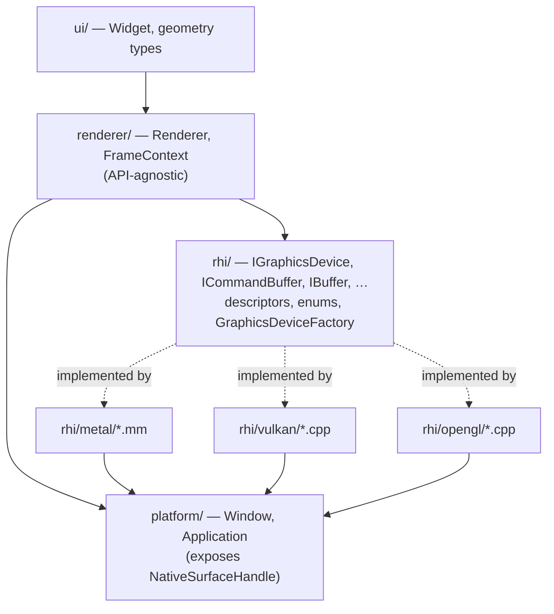
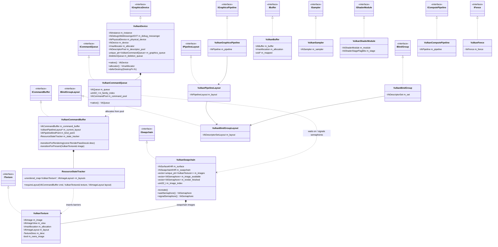
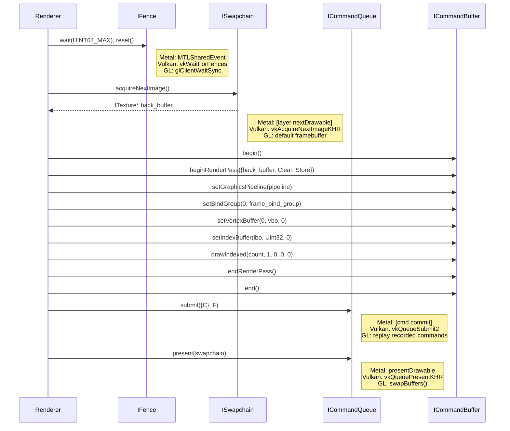

# Graphics API Abstraction (RHI)

A thin **Render Hardware Interface** that hides Metal, Vulkan and OpenGL behind a single set of
abstract interfaces. `Renderer` (and anything above it) only ever sees the interfaces in the
*Core abstraction* diagram; the concrete `Metal*`, `Vulkan*` and `GL*` classes are private to their
backend and are only reachable through `GraphicsDeviceFactory`.

The model is deliberately Vulkan/Metal-shaped (explicit devices, queues, command buffers, pipelines,
bind groups) because that maps cleanly *down* to OpenGL, whereas a GL-shaped API cannot map *up*
to the modern APIs without losing performance.

## Contents

1. [Layering](#1-layering)
2. [Core abstraction](#2-core-abstraction)
3. [Descriptors and enums](#3-descriptors-and-enums)
4. [Metal backend](#4-metal-backend)
5. [Vulkan backend](#5-vulkan-backend)
6. [OpenGL backend](#6-opengl-backend)
7. [A frame, end to end](#7-a-frame-end-to-end)
8. [Concept mapping](#8-concept-mapping)
9. [Design notes](#9-design-notes)

---

## 1. Layering

---

## 2. Core abstraction

Everything `Renderer` is allowed to touch. All `I*` types are pure interfaces (following the
project's `IWidget` convention); all objects are created by `IGraphicsDevice` and returned as
`std::unique_ptr`, so ownership is always explicit.

```mermaid
classDiagram
    direction TB

    class GraphicsDeviceFactory {
        <<static>>
        +create(const DeviceDesc& desc) unique_ptr~IGraphicsDevice~
        +isSupported(GraphicsAPI api) bool
        +defaultAPI() GraphicsAPI
    }

    class Window {
        +display()
        +setWindowTitle(const string& title)
        +nativeSurface() NativeSurfaceHandle
        +framebufferSize() Size
    }

    class NativeSurfaceHandle {
        +void* window
        +void* view
        +void* display
    }

    class Renderer {
        -unique_ptr~IGraphicsDevice~ m_device
        -unique_ptr~ISwapchain~ m_swapchain
        -array~FrameContext, MaxFramesInFlight~ m_frames
        -uint32_t m_frame_index
        +Renderer(Window& window, GraphicsAPI api)
        +beginFrame() bool
        +render()
        +endFrame()
        +resize(uint32_t width, uint32_t height)
        +device() IGraphicsDevice&
    }

    class FrameContext {
        +unique_ptr~ICommandBuffer~ command_buffer
        +unique_ptr~IFence~ in_flight_fence
        +unique_ptr~IBuffer~ uniform_buffer
        +unique_ptr~IBindGroup~ frame_bind_group
    }

    class IResource {
        <<interface>>
        +setDebugName(const string& name)
    }

    class IGraphicsDevice {
        <<interface>>
        +api() GraphicsAPI
        +capabilities() const DeviceCapabilities&
        +graphicsQueue() ICommandQueue&
        +createSwapchain(const SwapchainDesc& desc) unique_ptr~ISwapchain~
        +createBuffer(const BufferDesc& desc, const void* initial_data) unique_ptr~IBuffer~
        +createTexture(const TextureDesc& desc) unique_ptr~ITexture~
        +createSampler(const SamplerDesc& desc) unique_ptr~ISampler~
        +createShaderModule(const ShaderModuleDesc& desc) unique_ptr~IShaderModule~
        +createBindGroupLayout(const BindGroupLayoutDesc& desc) unique_ptr~IBindGroupLayout~
        +createBindGroup(const BindGroupDesc& desc) unique_ptr~IBindGroup~
        +createPipelineLayout(const PipelineLayoutDesc& desc) unique_ptr~IPipelineLayout~
        +createGraphicsPipeline(const GraphicsPipelineDesc& desc) unique_ptr~IGraphicsPipeline~
        +createComputePipeline(const ComputePipelineDesc& desc) unique_ptr~IComputePipeline~
        +createFence(bool signaled) unique_ptr~IFence~
        +waitIdle()
    }

    class ICommandQueue {
        <<interface>>
        +createCommandBuffer() unique_ptr~ICommandBuffer~
        +submit(span~ICommandBuffer*~ buffers, IFence* signal_fence)
        +present(ISwapchain& swapchain)
        +waitIdle()
    }

    class ICommandBuffer {
        <<interface>>
        +begin()
        +end()
        +beginRenderPass(const RenderPassDesc& desc)
        +endRenderPass()
        +setGraphicsPipeline(IGraphicsPipeline& pipeline)
        +setViewport(const Viewport& viewport)
        +setScissor(const ScissorRect& rect)
        +setVertexBuffer(uint32_t slot, IBuffer& buffer, uint64_t offset)
        +setIndexBuffer(IBuffer& buffer, IndexType type, uint64_t offset)
        +setBindGroup(uint32_t index, IBindGroup& group)
        +pushConstants(ShaderStage stages, const void* data, uint32_t size)
        +draw(uint32_t vertex_count, uint32_t instance_count, uint32_t first_vertex, uint32_t first_instance)
        +drawIndexed(uint32_t index_count, uint32_t instance_count, uint32_t first_index, int32_t vertex_offset, uint32_t first_instance)
        +beginComputePass()
        +endComputePass()
        +setComputePipeline(IComputePipeline& pipeline)
        +dispatch(uint32_t x, uint32_t y, uint32_t z)
        +copyBuffer(IBuffer& src, IBuffer& dst, const BufferCopyRegion& region)
        +copyBufferToTexture(IBuffer& src, ITexture& dst, const TextureCopyRegion& region)
        +pushDebugGroup(const string& label)
        +popDebugGroup()
    }

    class ISwapchain {
        <<interface>>
        +acquireNextImage() ITexture*
        +currentImage() ITexture&
        +resize(uint32_t width, uint32_t height)
        +format() TextureFormat
        +extent() Extent2D
        +setVSync(bool enabled)
    }

    class IBuffer {
        <<interface>>
        +size() uint64_t
        +usage() BufferUsage
        +map() void*
        +unmap()
        +update(const void* data, uint64_t size, uint64_t offset)
    }

    class ITexture {
        <<interface>>
        +desc() const TextureDesc&
        +format() TextureFormat
        +extent() Extent3D
        +mipLevels() uint32_t
    }

    class ISampler {
        <<interface>>
        +desc() const SamplerDesc&
    }

    class IShaderModule {
        <<interface>>
        +stage() ShaderStage
        +entryPoint() const string&
    }

    class IBindGroupLayout {
        <<interface>>
        +desc() const BindGroupLayoutDesc&
    }

    class IBindGroup {
        <<interface>>
        +layout() IBindGroupLayout&
    }

    class IPipelineLayout {
        <<interface>>
        +bindGroupLayoutCount() uint32_t
    }

    class IGraphicsPipeline {
        <<interface>>
        +layout() IPipelineLayout&
    }

    class IComputePipeline {
        <<interface>>
        +layout() IPipelineLayout&
    }

    class IFence {
        <<interface>>
        +wait(uint64_t timeout_ns) bool
        +reset()
        +isSignaled() bool
    }

    %% Inheritance from the common resource base
    IResource <|-- IBuffer
    IResource <|-- ITexture
    IResource <|-- ISampler
    IResource <|-- IShaderModule
    IResource <|-- IBindGroupLayout
    IResource <|-- IBindGroup
    IResource <|-- IPipelineLayout
    IResource <|-- IGraphicsPipeline
    IResource <|-- IComputePipeline
    IResource <|-- ICommandBuffer
    IResource <|-- IFence

    %% Renderer side (API-agnostic)
    Renderer --> Window : renders into
    Renderer *-- IGraphicsDevice
    Renderer *-- ISwapchain
    Renderer *-- "MaxFramesInFlight" FrameContext
    FrameContext *-- ICommandBuffer
    FrameContext *-- IFence
    FrameContext *-- IBuffer
    FrameContext *-- IBindGroup
    Window ..> NativeSurfaceHandle : provides

    %% Creation
    GraphicsDeviceFactory ..> IGraphicsDevice : creates
    IGraphicsDevice *-- ICommandQueue
    IGraphicsDevice ..> ISwapchain : creates
    IGraphicsDevice ..> IResource : creates
    ISwapchain ..> NativeSurfaceHandle : built from
    ICommandQueue ..> ICommandBuffer : creates / submits
    ICommandQueue ..> IFence : signals
    ICommandQueue ..> ISwapchain : presents

    %% Usage / references
    ISwapchain o-- "2..3" ITexture : back buffers
    ICommandBuffer ..> IGraphicsPipeline : binds
    ICommandBuffer ..> IComputePipeline : binds
    ICommandBuffer ..> IBuffer : reads / writes
    ICommandBuffer ..> ITexture : renders to
    ICommandBuffer ..> IBindGroup : binds
    IGraphicsPipeline --> IPipelineLayout
    IGraphicsPipeline --> "1..*" IShaderModule
    IComputePipeline --> IPipelineLayout
    IComputePipeline --> IShaderModule
    IPipelineLayout --> "0..*" IBindGroupLayout
    IBindGroup --> IBindGroupLayout
    IBindGroup --> "0..*" IBuffer
    IBindGroup --> "0..*" ITexture
    IBindGroup --> "0..*" ISampler
```

---

## 3. Descriptors and enums

Plain value types (no virtuals, no native types) used to create and configure objects. They live
alongside the interfaces and are shared by every backend.

```mermaid
classDiagram
    direction LR

    class DeviceDesc {
        +GraphicsAPI api
        +NativeSurfaceHandle surface
        +bool enable_validation
        +string application_name
    }

    class DeviceCapabilities {
        +string device_name
        +bool supports_compute
        +bool supports_push_constants
        +uint32_t max_texture_size
        +uint32_t max_bind_groups
        +uint32_t max_color_attachments
        +uint32_t uniform_buffer_alignment
        +ClipSpaceDepth clip_depth
        +bool framebuffer_origin_top_left
    }

    class SwapchainDesc {
        +NativeSurfaceHandle surface
        +Extent2D extent
        +TextureFormat format
        +uint32_t image_count
        +bool vsync
    }

    class BufferDesc {
        +uint64_t size
        +BufferUsage usage
        +MemoryType memory
    }

    class TextureDesc {
        +TextureType type
        +TextureFormat format
        +Extent3D extent
        +uint32_t mip_levels
        +uint32_t array_layers
        +uint32_t sample_count
        +TextureUsage usage
    }

    class SamplerDesc {
        +Filter min_filter
        +Filter mag_filter
        +Filter mip_filter
        +AddressMode address_u
        +AddressMode address_v
        +AddressMode address_w
        +float max_anisotropy
        +optional~CompareOp~ compare
    }

    class ShaderSource {
        +ShaderLanguage language
        +vector~uint8_t~ code
    }

    class ShaderModuleDesc {
        +ShaderStage stage
        +string entry_point
        +vector~ShaderSource~ sources
    }

    class BindGroupLayoutEntry {
        +uint32_t binding
        +BindingType type
        +ShaderStage visibility
        +uint32_t count
    }

    class BindGroupLayoutDesc {
        +vector~BindGroupLayoutEntry~ entries
    }

    class BindGroupEntry {
        +uint32_t binding
        +IBuffer* buffer
        +uint64_t offset
        +uint64_t range
        +ITexture* texture
        +ISampler* sampler
    }

    class BindGroupDesc {
        +IBindGroupLayout* layout
        +vector~BindGroupEntry~ entries
    }

    class PushConstantRange {
        +ShaderStage stages
        +uint32_t offset
        +uint32_t size
    }

    class PipelineLayoutDesc {
        +vector~IBindGroupLayout*~ bind_group_layouts
        +vector~PushConstantRange~ push_constants
    }

    class VertexBufferLayout {
        +uint32_t binding
        +uint32_t stride
        +VertexStepMode step_mode
    }

    class VertexAttribute {
        +uint32_t location
        +uint32_t binding
        +VertexFormat format
        +uint32_t offset
    }

    class VertexLayout {
        +vector~VertexBufferLayout~ buffers
        +vector~VertexAttribute~ attributes
    }

    class RasterState {
        +CullMode cull_mode
        +FrontFace front_face
        +PolygonMode polygon_mode
        +bool depth_clamp
    }

    class DepthStencilState {
        +bool depth_test
        +bool depth_write
        +CompareOp depth_compare
    }

    class BlendState {
        +bool enabled
        +BlendFactor src_color
        +BlendFactor dst_color
        +BlendOp color_op
        +BlendFactor src_alpha
        +BlendFactor dst_alpha
        +BlendOp alpha_op
        +ColorWriteMask write_mask
    }

    class GraphicsPipelineDesc {
        +IShaderModule* vertex_shader
        +IShaderModule* fragment_shader
        +IPipelineLayout* layout
        +VertexLayout vertex_layout
        +PrimitiveTopology topology
        +RasterState raster
        +DepthStencilState depth_stencil
        +vector~BlendState~ blend
        +vector~TextureFormat~ color_formats
        +TextureFormat depth_format
        +uint32_t sample_count
    }

    class ComputePipelineDesc {
        +IShaderModule* compute_shader
        +IPipelineLayout* layout
    }

    class ColorAttachment {
        +ITexture* texture
        +ITexture* resolve_texture
        +LoadOp load_op
        +StoreOp store_op
        +Color clear_color
    }

    class DepthAttachment {
        +ITexture* texture
        +LoadOp load_op
        +StoreOp store_op
        +float clear_depth
        +uint8_t clear_stencil
    }

    class RenderPassDesc {
        +vector~ColorAttachment~ color_attachments
        +optional~DepthAttachment~ depth_attachment
        +string label
    }

    class Viewport {
        +float x
        +float y
        +float width
        +float height
        +float min_depth
        +float max_depth
    }

    class ScissorRect {
        +int32_t x
        +int32_t y
        +uint32_t width
        +uint32_t height
    }

    class BufferCopyRegion {
        +uint64_t src_offset
        +uint64_t dst_offset
        +uint64_t size
    }

    class TextureCopyRegion {
        +uint64_t buffer_offset
        +uint32_t bytes_per_row
        +uint32_t mip_level
        +uint32_t array_layer
        +Offset3D origin
        +Extent3D extent
    }

    ShaderModuleDesc *-- "1..*" ShaderSource
    BindGroupLayoutDesc *-- "0..*" BindGroupLayoutEntry
    BindGroupDesc *-- "0..*" BindGroupEntry
    PipelineLayoutDesc *-- "0..*" PushConstantRange
    VertexLayout *-- VertexBufferLayout
    VertexLayout *-- VertexAttribute
    GraphicsPipelineDesc *-- VertexLayout
    GraphicsPipelineDesc *-- RasterState
    GraphicsPipelineDesc *-- DepthStencilState
    GraphicsPipelineDesc *-- "1..*" BlendState
    RenderPassDesc *-- "0..*" ColorAttachment
    RenderPassDesc *-- "0..1" DepthAttachment

    class GraphicsAPI {
        <<enumeration>>
        Auto
        Metal
        Vulkan
        OpenGL
    }

    class BufferUsage {
        <<enumeration>>
        Vertex
        Index
        Uniform
        Storage
        Indirect
        CopySrc
        CopyDst
    }

    class MemoryType {
        <<enumeration>>
        GpuOnly
        CpuToGpu
        GpuToCpu
    }

    class TextureType {
        <<enumeration>>
        Texture1D
        Texture2D
        Texture3D
        TextureCube
        Texture2DArray
    }

    class TextureFormat {
        <<enumeration>>
        Undefined
        R8Unorm
        RG8Unorm
        RGBA8Unorm
        RGBA8Srgb
        BGRA8Unorm
        BGRA8Srgb
        R16Float
        RGBA16Float
        R32Float
        RGBA32Float
        Depth32Float
        Depth24Stencil8
    }

    class TextureUsage {
        <<enumeration>>
        Sampled
        Storage
        ColorAttachment
        DepthStencilAttachment
        CopySrc
        CopyDst
    }

    class ShaderStage {
        <<enumeration>>
        Vertex
        Fragment
        Compute
    }

    class ShaderLanguage {
        <<enumeration>>
        SPIRV
        MSL
        MetalLib
        GLSL
    }

    class BindingType {
        <<enumeration>>
        UniformBuffer
        StorageBuffer
        SampledTexture
        StorageTexture
        Sampler
        CombinedTextureSampler
    }

    class PrimitiveTopology {
        <<enumeration>>
        PointList
        LineList
        LineStrip
        TriangleList
        TriangleStrip
    }

    class IndexType {
        <<enumeration>>
        Uint16
        Uint32
    }

    class LoadOp {
        <<enumeration>>
        Load
        Clear
        DontCare
    }

    class StoreOp {
        <<enumeration>>
        Store
        DontCare
    }

    class CompareOp {
        <<enumeration>>
        Never
        Less
        Equal
        LessEqual
        Greater
        NotEqual
        GreaterEqual
        Always
    }

    class CullMode {
        <<enumeration>>
        None
        Front
        Back
    }

    class ClipSpaceDepth {
        <<enumeration>>
        ZeroToOne
        NegativeOneToOne
    }
```

Smaller enums referenced above (`Filter`, `AddressMode`, `VertexFormat`, `VertexStepMode`,
`FrontFace`, `PolygonMode`, `BlendFactor`, `BlendOp`, `ColorWriteMask`) follow the same pattern and
are omitted from the diagram for readability. `BufferUsage`, `TextureUsage`, `ShaderStage` and
`ColorWriteMask` are bit flags (`enum class` with `operator|`).

---

## 4. Metal backend

Lives in `rhi/metal/*.mm`. Headers for these classes are only included from `.mm` files, so they
may hold Objective-C types directly (manual retain/release — ARC is off in this project).

```mermaid
classDiagram
    direction TB

    class IGraphicsDevice
    <<interface>> IGraphicsDevice
    class ICommandQueue
    <<interface>> ICommandQueue
    class ICommandBuffer
    <<interface>> ICommandBuffer
    class ISwapchain
    <<interface>> ISwapchain
    class IBuffer
    <<interface>> IBuffer
    class ITexture
    <<interface>> ITexture
    class ISampler
    <<interface>> ISampler
    class IShaderModule
    <<interface>> IShaderModule
    class IBindGroupLayout
    <<interface>> IBindGroupLayout
    class IBindGroup
    <<interface>> IBindGroup
    class IPipelineLayout
    <<interface>> IPipelineLayout
    class IGraphicsPipeline
    <<interface>> IGraphicsPipeline
    class IComputePipeline
    <<interface>> IComputePipeline
    class IFence
    <<interface>> IFence

    class MetalDevice {
        -id~MTLDevice~ m_device
        -unique_ptr~MetalCommandQueue~ m_queue
        -DeviceCapabilities m_capabilities
        +MetalDevice(const DeviceDesc& desc)
        +native() id~MTLDevice~
    }

    class MetalCommandQueue {
        -id~MTLCommandQueue~ m_queue
        +native() id~MTLCommandQueue~
    }

    class MetalCommandBuffer {
        -id~MTLCommandBuffer~ m_command_buffer
        -id~MTLRenderCommandEncoder~ m_render_encoder
        -id~MTLComputeCommandEncoder~ m_compute_encoder
        -id~MTLBlitCommandEncoder~ m_blit_encoder
        -MetalGraphicsPipeline* m_current_pipeline
        -id~MTLBuffer~ m_index_buffer
        -MTLIndexType m_index_type
        -uint64_t m_index_offset
        -blitEncoder() id~MTLBlitCommandEncoder~
        -endActiveEncoder()
    }

    class MetalSwapchain {
        -CAMetalLayer* m_layer
        -id~CAMetalDrawable~ m_drawable
        -unique_ptr~MetalTexture~ m_current_texture
    }

    class MetalBuffer {
        -id~MTLBuffer~ m_buffer
        -MTLResourceOptions m_options
    }

    class MetalTexture {
        -id~MTLTexture~ m_texture
        -TextureDesc m_desc
        -bool m_owns_texture
    }

    class MetalSampler {
        -id~MTLSamplerState~ m_sampler
    }

    class MetalShaderModule {
        -id~MTLLibrary~ m_library
        -id~MTLFunction~ m_function
    }

    class MetalBindGroupLayout {
        -BindGroupLayoutDesc m_desc
    }

    class MetalBindGroup {
        -vector~BindGroupEntry~ m_entries
        -id~MTLBuffer~ m_argument_buffer
        +bind(id~MTLRenderCommandEncoder~ encoder, uint32_t group_index)
        +bind(id~MTLComputeCommandEncoder~ encoder, uint32_t group_index)
    }

    class MetalPipelineLayout {
        -vector~IBindGroupLayout*~ m_layouts
        -BindingSlotMap m_slot_map
        +slotFor(uint32_t group, uint32_t binding) uint32_t
    }

    class MetalGraphicsPipeline {
        -id~MTLRenderPipelineState~ m_pipeline_state
        -id~MTLDepthStencilState~ m_depth_stencil_state
        -MTLPrimitiveType m_primitive_type
        -MTLCullMode m_cull_mode
        -MTLWinding m_winding
    }

    class MetalComputePipeline {
        -id~MTLComputePipelineState~ m_pipeline_state
        -MTLSize m_threads_per_group
    }

    class MetalFence {
        -id~MTLSharedEvent~ m_event
        -uint64_t m_signal_value
    }

    IGraphicsDevice <|.. MetalDevice
    ICommandQueue <|.. MetalCommandQueue
    ICommandBuffer <|.. MetalCommandBuffer
    ISwapchain <|.. MetalSwapchain
    IBuffer <|.. MetalBuffer
    ITexture <|.. MetalTexture
    ISampler <|.. MetalSampler
    IShaderModule <|.. MetalShaderModule
    IBindGroupLayout <|.. MetalBindGroupLayout
    IBindGroup <|.. MetalBindGroup
    IPipelineLayout <|.. MetalPipelineLayout
    IGraphicsPipeline <|.. MetalGraphicsPipeline
    IComputePipeline <|.. MetalComputePipeline
    IFence <|.. MetalFence

    MetalDevice *-- MetalCommandQueue
    MetalCommandQueue ..> MetalCommandBuffer : creates
    MetalSwapchain *-- MetalTexture : wraps drawable
    MetalCommandBuffer ..> MetalGraphicsPipeline : caches primitive type
    MetalCommandBuffer ..> MetalBindGroup : binds
    MetalGraphicsPipeline --> MetalPipelineLayout
    MetalBindGroup --> MetalBindGroupLayout
```

---

## 5. Vulkan backend

Lives in `rhi/vulkan/*.cpp`. Targets Vulkan 1.3 with **dynamic rendering**, so there are no
`VkRenderPass`/`VkFramebuffer` objects to expose. On macOS this runs through MoltenVK.

---

## 6. OpenGL backend

Lives in `rhi/opengl/*.cpp`. OpenGL has no command buffers, so `GLCommandBuffer` **records**
commands into a list and `GLCommandQueue::submit` **replays** them on the context's thread. This
keeps the `Renderer` code identical across all three APIs.

```mermaid
classDiagram
    direction TB

    class IGraphicsDevice
    <<interface>> IGraphicsDevice
    class ICommandQueue
    <<interface>> ICommandQueue
    class ICommandBuffer
    <<interface>> ICommandBuffer
    class ISwapchain
    <<interface>> ISwapchain
    class IBuffer
    <<interface>> IBuffer
    class ITexture
    <<interface>> ITexture
    class ISampler
    <<interface>> ISampler
    class IShaderModule
    <<interface>> IShaderModule
    class IBindGroupLayout
    <<interface>> IBindGroupLayout
    class IBindGroup
    <<interface>> IBindGroup
    class IPipelineLayout
    <<interface>> IPipelineLayout
    class IGraphicsPipeline
    <<interface>> IGraphicsPipeline
    class IComputePipeline
    <<interface>> IComputePipeline
    class IFence
    <<interface>> IFence

    class GLContext {
        <<interface>>
        +makeCurrent()
        +swapBuffers()
        +setSwapInterval(int interval)
        +getProcAddress(const char* name) void*
    }

    class NSGLContext {
        -NSOpenGLContext* m_context
    }

    class WGLContext {
        -HDC m_hdc
        -HGLRC m_hglrc
    }

    class GLDevice {
        -unique_ptr~GLContext~ m_context
        -unique_ptr~GLCommandQueue~ m_queue
        -GLStateCache m_state_cache
        -GLFramebufferCache m_framebuffer_cache
        -DeviceCapabilities m_capabilities
    }

    class GLCommandQueue {
        -GLDevice& m_device
        -execute(const GLCommand& command)
    }

    class GLCommandBuffer {
        -vector~GLCommand~ m_commands
        +commands() const vector~GLCommand~&
    }

    class GLCommand {
        <<variant>>
        BeginRenderPass
        EndRenderPass
        SetPipeline
        SetViewport
        SetScissor
        SetVertexBuffer
        SetIndexBuffer
        SetBindGroup
        PushConstants
        Draw
        DrawIndexed
        Dispatch
        CopyBuffer
        CopyBufferToTexture
    }

    class GLStateCache {
        -GLuint m_program
        -GLuint m_vao
        -GLuint m_framebuffer
        -RasterState m_raster
        -DepthStencilState m_depth_stencil
        -BlendState m_blend
        +apply(const GLGraphicsPipeline& pipeline)
    }

    class GLFramebufferCache {
        -unordered_map~FramebufferKey, GLuint~ m_framebuffers
        +get(const RenderPassDesc& desc) GLuint
    }

    class GLSwapchain {
        -GLContext& m_context
        -unique_ptr~GLTexture~ m_default_framebuffer
    }

    class GLBuffer {
        -GLuint m_id
        -GLenum m_target
        -GLenum m_usage_hint
    }

    class GLTexture {
        -GLuint m_id
        -GLenum m_target
        -GLenum m_internal_format
        -bool m_is_default_framebuffer
    }

    class GLSampler {
        -GLuint m_id
    }

    class GLShaderModule {
        -GLuint m_shader
        -GLenum m_stage
    }

    class GLBindGroupLayout {
        -BindGroupLayoutDesc m_desc
    }

    class GLBindGroup {
        -vector~BindGroupEntry~ m_entries
        +apply(const GLPipelineLayout& layout, uint32_t group_index)
    }

    class GLPipelineLayout {
        -BindingSlotMap m_slot_map
        -GLuint m_push_constant_ubo
    }

    class GLGraphicsPipeline {
        -GLuint m_program
        -GLuint m_vao
        -GLenum m_topology
        -RasterState m_raster
        -DepthStencilState m_depth_stencil
        -vector~BlendState~ m_blend
    }

    class GLComputePipeline {
        -GLuint m_program
    }

    class GLFence {
        -GLsync m_sync
    }

    IGraphicsDevice <|.. GLDevice
    ICommandQueue <|.. GLCommandQueue
    ICommandBuffer <|.. GLCommandBuffer
    ISwapchain <|.. GLSwapchain
    IBuffer <|.. GLBuffer
    ITexture <|.. GLTexture
    ISampler <|.. GLSampler
    IShaderModule <|.. GLShaderModule
    IBindGroupLayout <|.. GLBindGroupLayout
    IBindGroup <|.. GLBindGroup
    IPipelineLayout <|.. GLPipelineLayout
    IGraphicsPipeline <|.. GLGraphicsPipeline
    IComputePipeline <|.. GLComputePipeline
    IFence <|.. GLFence

    GLContext <|.. NSGLContext
    GLContext <|.. WGLContext
    GLDevice *-- GLContext
    GLDevice *-- GLCommandQueue
    GLDevice *-- GLStateCache
    GLDevice *-- GLFramebufferCache
    GLCommandBuffer *-- "0..*" GLCommand : records
    GLCommandQueue ..> GLCommandBuffer : replays
    GLCommandQueue ..> GLStateCache : uses
    GLCommandQueue ..> GLFramebufferCache : uses
    GLSwapchain --> GLContext : presents via
    GLSwapchain *-- GLTexture : default framebuffer (id 0)
    GLGraphicsPipeline --> GLPipelineLayout
    GLBindGroup --> GLBindGroupLayout
```

---

## 7. A frame, end to end

The same `Renderer` code drives every backend; only the boxes on the right change.

---

## 8. Concept mapping

| Abstraction          | Metal                                    | Vulkan                                  | OpenGL                                   |
|----------------------|------------------------------------------|-----------------------------------------|------------------------------------------|
| `IGraphicsDevice`    | `MTLDevice`                              | `VkInstance` + `VkDevice` + VMA         | GL context                               |
| `ICommandQueue`      | `MTLCommandQueue`                        | `VkQueue` + `VkCommandPool`             | replay loop on the context thread        |
| `ICommandBuffer`     | `MTLCommandBuffer` + encoders            | `VkCommandBuffer`                       | recorded `vector<GLCommand>`             |
| `ISwapchain`         | `CAMetalLayer` / `CAMetalDrawable`       | `VkSwapchainKHR` + semaphores           | default framebuffer + `swapBuffers`      |
| `IBuffer`            | `MTLBuffer`                              | `VkBuffer` + `VmaAllocation`            | buffer object (`glGenBuffers`)           |
| `ITexture`           | `MTLTexture`                             | `VkImage` + `VkImageView`               | texture object                           |
| `ISampler`           | `MTLSamplerState`                        | `VkSampler`                             | sampler object                           |
| `IShaderModule`      | `MTLLibrary` + `MTLFunction`             | `VkShaderModule`                        | shader object                            |
| `IBindGroupLayout`   | slot map (CPU only)                      | `VkDescriptorSetLayout`                 | slot map (CPU only)                      |
| `IBindGroup`         | argument buffer / `set*Buffer` calls     | `VkDescriptorSet`                       | `glBindBufferRange` / `glBindTextureUnit`|
| `IPipelineLayout`    | binding-slot remap table                 | `VkPipelineLayout`                      | binding-slot remap + push-constant UBO   |
| `IGraphicsPipeline`  | `MTLRenderPipelineState` + depth state   | `VkPipeline`                            | program + VAO + cached fixed-function state |
| `beginRenderPass`    | `renderCommandEncoderWithDescriptor:`    | `vkCmdBeginRendering`                   | bind cached FBO, `glClear*`              |
| `pushConstants`      | `setVertexBytes` / `setFragmentBytes`    | `vkCmdPushConstants`                    | small UBO update                         |
| `IFence`             | `MTLSharedEvent`                         | `VkFence`                               | `GLsync`                                 |

---

## 9. Design notes

- **Runtime backend selection.** Unlike `Window` (one implementation per OS chosen at compile time
  via pimpl), the graphics backend is chosen at *runtime* — e.g. Vulkan *or* OpenGL on Windows,
  Metal *or* Vulkan-via-MoltenVK on macOS — so the RHI uses virtual interfaces instead of pimpl.
  `GraphicsAPI::Auto` picks Metal on macOS and Vulkan elsewhere, falling back to OpenGL. Backends
  can still be compiled out per platform with CMake options (`MANGO_RHI_METAL`, `MANGO_RHI_VULKAN`,
  `MANGO_RHI_OPENGL`).
- **No native types in the interfaces.** Headers in `rhi/` stay plain C++ (same rule as
  `platform/`). The only bridge to the OS is `NativeSurfaceHandle`, which `Window` fills with
  `NSView*`/`CAMetalLayer*` on macOS and `HWND`/`HINSTANCE` on Windows.
- **Barriers are hidden.** Metal and OpenGL track hazards automatically; the Vulkan backend
  reproduces that with `ResourceStateTracker`, which inserts image-layout transitions inside
  `beginRenderPass`, `copyBufferToTexture` and `present`. If explicit control is ever needed, a
  `resourceBarrier()` that is a no-op on Metal/GL can be added to `ICommandBuffer` later.
- **Shaders.** Author once (GLSL/HLSL/Slang), compile offline to SPIR-V, then cross-compile with
  SPIRV-Cross to MSL and GLSL. `ShaderModuleDesc::sources` carries every variant and each device
  picks the `ShaderLanguage` it understands.
- **Bind-group → slot remapping.** Vulkan uses `(set, binding)` natively. Metal and OpenGL have
  flat slot tables, so `MetalPipelineLayout` / `GLPipelineLayout` build a `BindingSlotMap` from
  `(group, binding)` to a flat index, and SPIRV-Cross is given the same mapping.
- **Coordinate conventions.** `DeviceCapabilities::clip_depth` and `framebuffer_origin_top_left`
  expose differences (GL's `[-1, 1]` depth and bottom-left origin) so the renderer can adjust its
  projection matrix once; alternatively the GL backend can use `glClipControl` (GL 4.5, not
  available on macOS).
- **Object lifetime.** Destroying a resource still in use by the GPU is deferred: Vulkan pushes
  destruction onto `DeletionQueue`, flushed when the owning frame's fence signals; Metal retains
  resources via the command buffer; OpenGL defers deletion naturally.
- **OpenGL on macOS** is capped at 4.1 (deprecated, no compute, no `glClipControl`), so
  `DeviceCapabilities::supports_compute` is `false` there and compute paths must check it.
- **Suggested layout:** `rhi/` (interfaces, descriptors, enums, `GraphicsDeviceFactory`) as a new
  static library `RHI` linking `Platform`; `rhi/metal/`, `rhi/vulkan/`, `rhi/opengl/` as backend
  sources; `renderer/` (`Renderer`, `FrameContext`) as a library `Renderer` linking `RHI`. Header
  names stay unique (`MetalBuffer.h`, `VulkanBuffer.h`, `GLBuffer.h`) per the bare-include rule.
